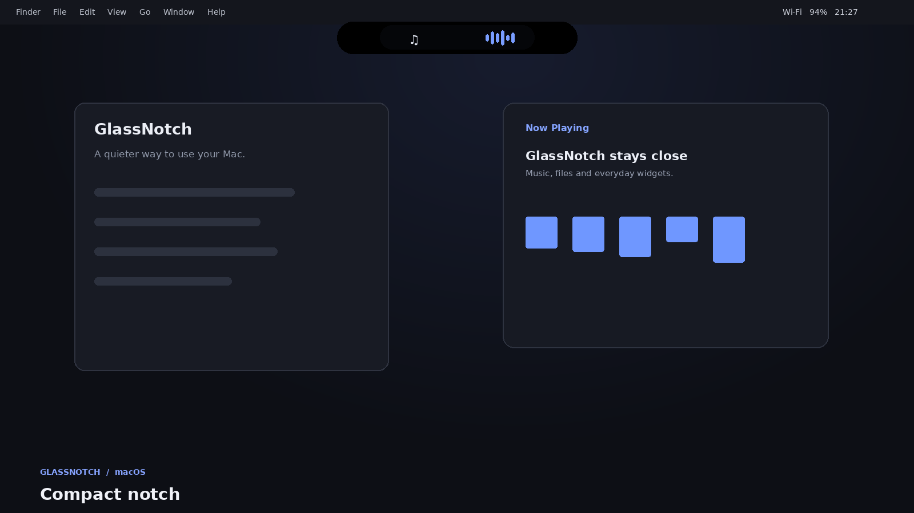
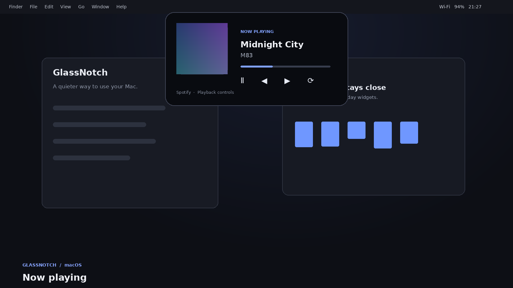
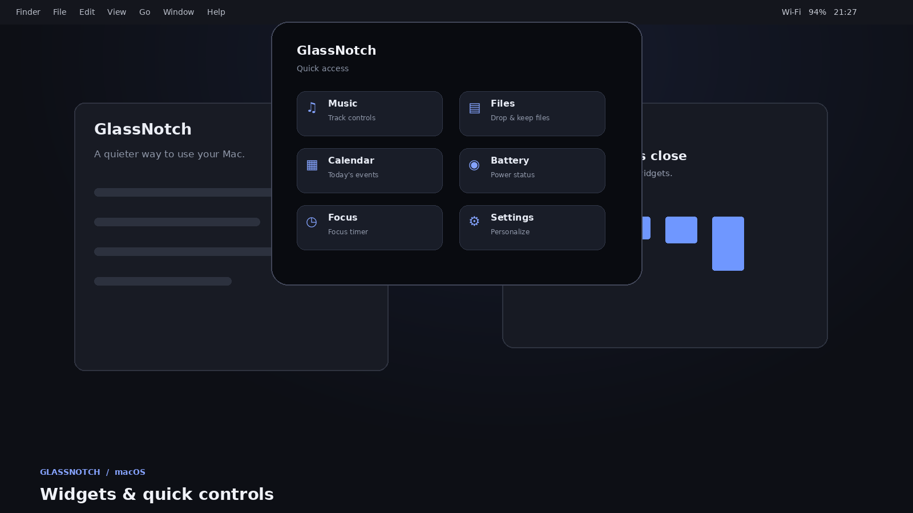

<div align="center">

# GlassNotch

**A cleaner way to use your Mac's notch.**

A native macOS utility for music, files, calendar events, battery status and focus tools — right at the top of your screen.

[Download for macOS](https://github.com/maTTvey-web/GlassNotch/releases/latest) · [Source code](https://github.com/maTTvey-web/GlassNotch) · [Report an issue](https://github.com/maTTvey-web/GlassNotch/issues)


</div>

---

## Overview

GlassNotch turns the space around the macOS notch into a compact control panel. It stays out of the way when you don't need it and expands when you do.

The interface brings together everyday controls without opening another app: manage playback, keep files nearby, check your calendar, monitor battery level or start a focus session.

## Interface previews

<p align="center">
  
</p>

<p align="center">
  
</p>

<p align="center">
  
</p>

> These are illustrative interface previews, not screenshots captured from a running build. Replace them with real screenshots as the project UI evolves.

## Features

- **Now Playing** — view track details and artwork, control playback and scrub through a track.
- **Browser music** — detect media from supported browser tabs, including YouTube, SoundCloud, Spotify Web and Apple Music Web.
- **File shelf** — drop files onto the notch to keep them temporarily accessible, then open or remove them.
- **Calendar** — see today's events in the expanded panel.
- **Battery status** — check charge level and charging state, with an optional low-battery indicator.
- **Focus timer** — switch between focus and break sessions.
- **Notes** — keep a quick note close at hand.
- **Appearance settings** — choose an accent color, adjust the panel size and configure the compact notch indicators.
- **Language options** — use the system language or select a supported language in Settings.
- **Launch at login** — optionally start GlassNotch when you sign in.

Available features can depend on macOS permissions, the selected settings and the media app or browser being used.

## Download

**Recommended: download the macOS disk image from Releases.**

1. Open [GlassNotch Releases](https://github.com/maTTvey-web/GlassNotch/releases/latest).
2. Download `GlassNotch.dmg` from the latest release assets.
3. Open the downloaded `.dmg` file.
4. Drag `GlassNotch.app` into the **Applications** folder.
5. Open GlassNotch from Applications.

If macOS blocks the app because it is not notarized, use caution and only proceed if you trust the build and its source. The project can also be built locally from source using the steps below.

## First launch

Some features need permission to work:

- **Automation** may be required to read or control playback in Spotify, Music or supported browsers.
- **Calendar access** is needed to show calendar events.
- **Accessibility / browser automation settings** may be required for certain browser interactions, depending on the browser and macOS version.

If a feature does not respond, open **System Settings → Privacy & Security** and review the relevant permission. You can also disable integrations you do not use in GlassNotch Settings.

## Build from source

### Requirements

- macOS 14 or later
- Xcode or the Xcode Command Line Tools
- Swift compiler

### Build and run

```bash
git clone https://github.com/maTTvey-web/GlassNotch.git
cd GlassNotch/GlassNotch
bash build.sh
open build/GlassNotch.app
```

### Create a DMG

Run this from the `GlassNotch` directory:

```bash
bash make-dmg.sh
```

The script builds the app and creates `GlassNotch.dmg` in the repository's parent directory.

## Configuration

Open GlassNotch Settings from the expanded panel or the app menu. Depending on the current build, you can configure:

- Language and launch-at-login behavior
- Calendar and battery indicators
- Accent color and panel dimensions
- Music artwork and equalizer indicators
- File shelf behavior
- Focus and break duration

## Tech stack

- **Swift**
- **SwiftUI**
- **AppKit**
- **EventKit** for calendar events
- **AppleScript / browser JavaScript** for supported media controls
- **IOKit Power Sources** for battery information

## Project structure

```text
GlassNotch/
├── Sources/
│   └── GlassNotchApp.swift
├── Info.plist
├── build.sh
├── make-dmg.sh
└── LICENSE
```

## Issues and feedback

Found a bug or have an idea? Open an [issue](https://github.com/maTTvey-web/GlassNotch/issues) with your macOS version, steps to reproduce and any relevant screenshots or logs.

## License

See [`GlassNotch/LICENSE`](GlassNotch/LICENSE) for the license terms.

---

<div align="center">

Made for macOS by **[MaTTvey-web](https://github.com/maTTvey-web)**

</div>
